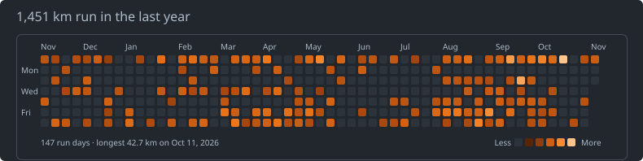

# kilometre-heatmap

A GitHub-contributions-style heatmap of daily running distance from Garmin Connect data

[](https://github.com/leblanchannah/kilometre-heatmap)


## How it works

| File | Role |
|---|---|
| `fetch_garmin.py` | Uses the official [Garmin Connect Personal API](https://developer.garmin.com/gc-developer-program/personal/personal-api/) with your personal API key, keeps running activities only (road, trail, treadmill, track), converts start times to your timezone, and writes `daily_km.csv` (`date,km`). |
| `make_svg.py` | Turns `daily_km.csv` into `runs.svg` (a 7×53 grid on a continuous orange scale). |
| `update.sh` | Fetches, renders, then commits and pushes `runs.svg` and `daily_km.csv` if they changed. |
| `config.example.toml` | Username, units (km/mi), timezone, colour scale, colours. |
| `sample_daily_km.csv` | Fake data, so you can try the renderer without a Garmin account. |

## Try it with sample data

Needs Python 3.11 or newer.

```bash
python3 make_svg.py --csv sample_daily_km.csv --out runs.svg
```

## Set up with Garmin

```bash
git clone https://github.com/leblanchannah/kilometre-heatmap && cd kilometre-heatmap
python3 -m venv .venv && .venv/bin/pip install -r requirements.txt
cp config.example.toml config.toml   # edit timezone, colour scale
cp .env.example .env                 # paste your GARMIN_API_KEY
.venv/bin/python fetch_garmin.py
.venv/bin/python make_svg.py
```

## Add to your profile README

```markdown
[](https://github.com/leblanchannah/kilometre-heatmap)
```

## Tests

The tests use mock Garmin responses only:

```bash
python3 -m pytest tests
```
